# Installation de Proxmox VE 9.2 sous VMware Workstation Pro

> [!NOTE]
> - **Travaux pratiques :** Module 190 · Mettre en place et exploiter une plateforme de virtualisation
> - **Auteur :** Lami · **Date :** 26 octobre 2026
> - **Objectif :** installer l'hyperviseur open source **Proxmox VE 9.2** dans des machines virtuelles VMware Workstation, l'administrer depuis son interface web, puis réunir deux nœuds en cluster.

---

## Sommaire

1. [Contexte : ESXi ou Proxmox VE ?](#1-contexte--esxi-ou-proxmox-ve-)
2. [Environnement de travail](#2-environnement-de-travail)
3. [Téléchargement de l'ISO](#3-téléchargement-de-liso)
4. [Création de la machine virtuelle](#4-création-de-la-machine-virtuelle)
5. [Installation de Proxmox VE](#5-installation-de-proxmox-ve)
6. [Accès à l'interface web](#6-accès-à-linterface-web)
7. [Deuxième nœud et cluster](#7-deuxième-nœud-et-cluster)
8. [Problèmes rencontrés et résolutions](#8-problèmes-rencontrés-et-résolutions)
9. [Bilan](#9-bilan)
10. [Glossaire](#10-glossaire)

---

## 1. Contexte : ESXi ou Proxmox VE ?

Comme VMware ESXi (TP précédent), **Proxmox VE** est un **hyperviseur de type 1** : il s'installe directement sur le matériel d'un serveur pour y faire tourner des machines virtuelles.

| | VMware ESXi | Proxmox VE |
|---|---|---|
| Éditeur / licence | Broadcom, propriétaire et payant | Proxmox Server Solutions, **open source et gratuit** (abonnement facultatif pour le support) |
| Base | noyau VMware propriétaire (VMkernel) | **Debian 13 Linux** |
| Virtualisation | machines virtuelles uniquement | **VM complètes (KVM)** et **conteneurs (LXC)** |
| Interface web | ESXi Host Client (port 443) | interface Proxmox (**port 8006**) |
| Plusieurs serveurs | nécessite vCenter (payant) | **cluster intégré**, géré depuis n'importe quel nœud |
| Ligne de commande | limitée (ESXCLI) | shell Linux complet (`apt`, `nano`, `systemctl`…) |

**KVM ou conteneur ?**
- **KVM (Full Virtualization)** : une machine virtuelle complète avec son propre noyau. Elle peut faire tourner Windows comme Linux.
- **Conteneur LXC** : il partage le noyau Linux de Proxmox. C'est très léger (1 à 3 % de perte de performances), mais réservé aux systèmes Linux.

Comme au TP précédent, Proxmox est installé **dans une VM Workstation** (virtualisation imbriquée, *nested virtualization*).

---

## 2. Environnement de travail

| Élément | Valeur |
|---|---|
| Processeur | Intel Core i9-14900HX (24 cœurs, 32 threads) |
| Mémoire vive | 32 Go |
| Système hôte | Windows 11 |
| Hyperviseur de type 2 | VMware Workstation Pro 25H2u1 |
| Image d'installation | `proxmox-ve_9.2-1.iso` (amd64) |

---

## 3. Téléchargement de l'ISO

L'ISO se télécharge sur la page officielle [proxmox.com → Downloads](https://www.proxmox.com/en/downloads/proxmox-virtual-environment/iso).

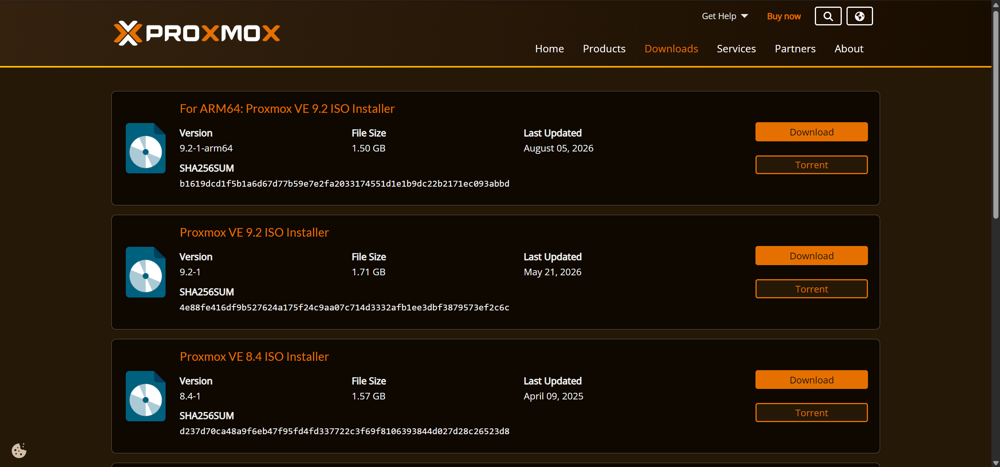

*Page de téléchargement : on choisit **Proxmox VE 9.2 ISO Installer**, et non la version « For ARM64 ».*

> [!WARNING]
> Un PC équipé d'un processeur Intel ou AMD utilise l'architecture **x86-64 (amd64)**. L'ISO **arm64** est destinée aux processeurs ARM et ne démarrera pas (voir [section 8](#8-problèmes-rencontrés-et-résolutions)).

---

## 4. Création de la machine virtuelle

**Fichier → Nouvelle machine virtuelle → Personnalisée (avancée)**. Ce mode permet de régler soi-même le processeur, la mémoire, le disque et le réseau.

### 4.1 Image ISO et système invité

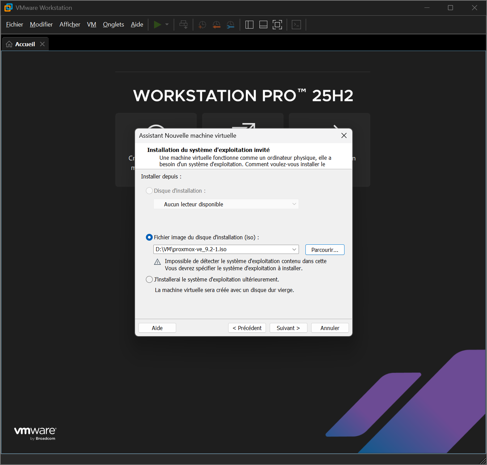

*Capture 01 : ISO `proxmox-ve_9.2-1.iso`. Workstation ne reconnaît pas Proxmox automatiquement, ce qui est normal.*

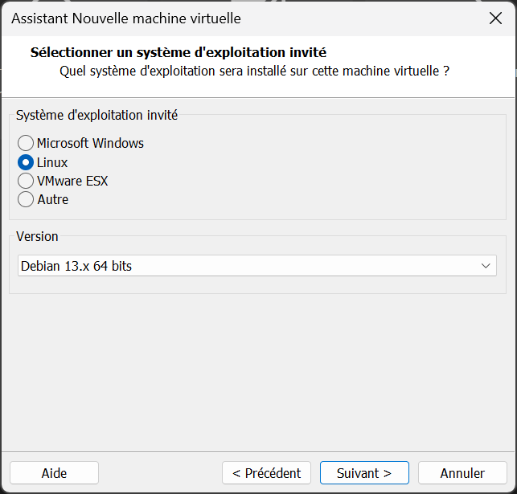

*Capture 02 : **Linux → Debian 13.x 64 bits**. Proxmox VE 9 est construit sur Debian 13, donc Workstation choisit les bons pilotes virtuels.*

- **Nom :** `PVE-01` (PVE = *Proxmox Virtual Environment*) · **Emplacement :** `D:\VM\PVE-01`

### 4.2 Processeurs

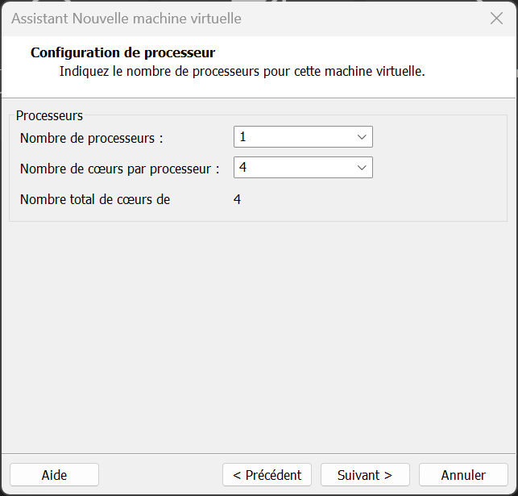

*Capture 03 : 1 processeur × 4 cœurs = 4 cœurs. Proxmox doit pouvoir faire tourner des VM à l'intérieur de lui, donc on lui laisse de la marge.*

### 4.3 Mémoire

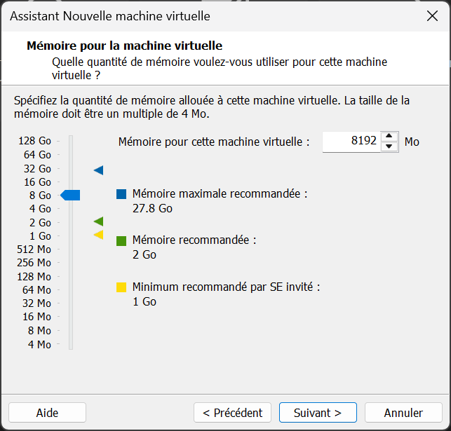

*Capture 04 : 8192 Mo (8 Go). Proxmox utilise environ 1 à 2 Go, le reste est disponible pour ses propres VM. Avec deux nœuds à 8 Go, il reste 16 Go au PC hôte.*

### 4.4 Réseau

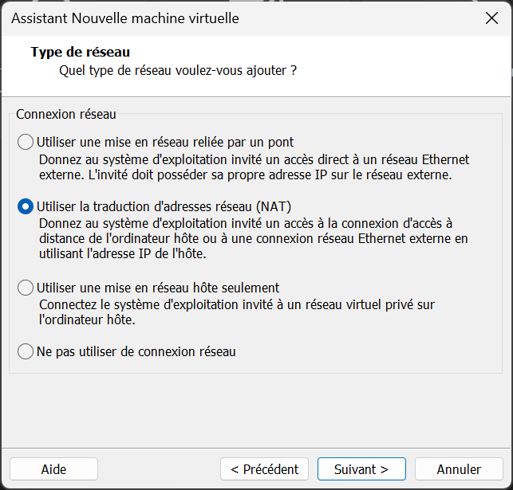

*Capture 05 : mode **NAT**. La VM sort sur Internet via le PC hôte, et le PC peut joindre l'interface web de Proxmox.*

### 4.5 Disque

Contrôleur E/S, type de disque (SCSI) et « Créer un nouveau disque virtuel » : valeurs par défaut. Proxmox étant un Linux, il reconnaît ces contrôleurs sans pilote particulier.

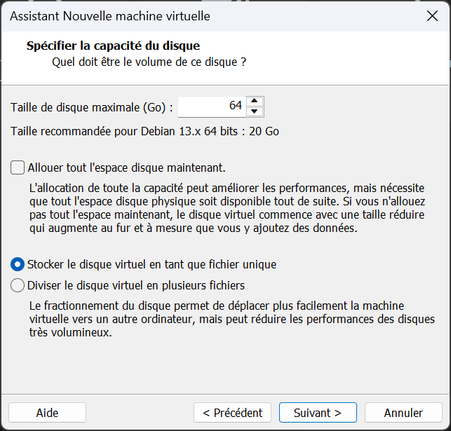

*Capture 06 : 64 Go, **non alloué d'avance** (provisionnement dynamique, *thin*), stocké en **fichier unique**. 20 Go suffiraient pour Proxmox seul, mais le disque accueillera aussi des ISO et les disques des futures VM.*

### 4.6 Récapitulatif et moteur de virtualisation

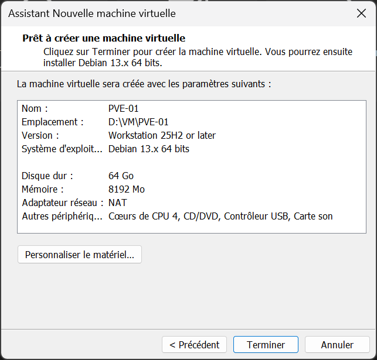

*Capture 07 : récapitulatif avant création.*

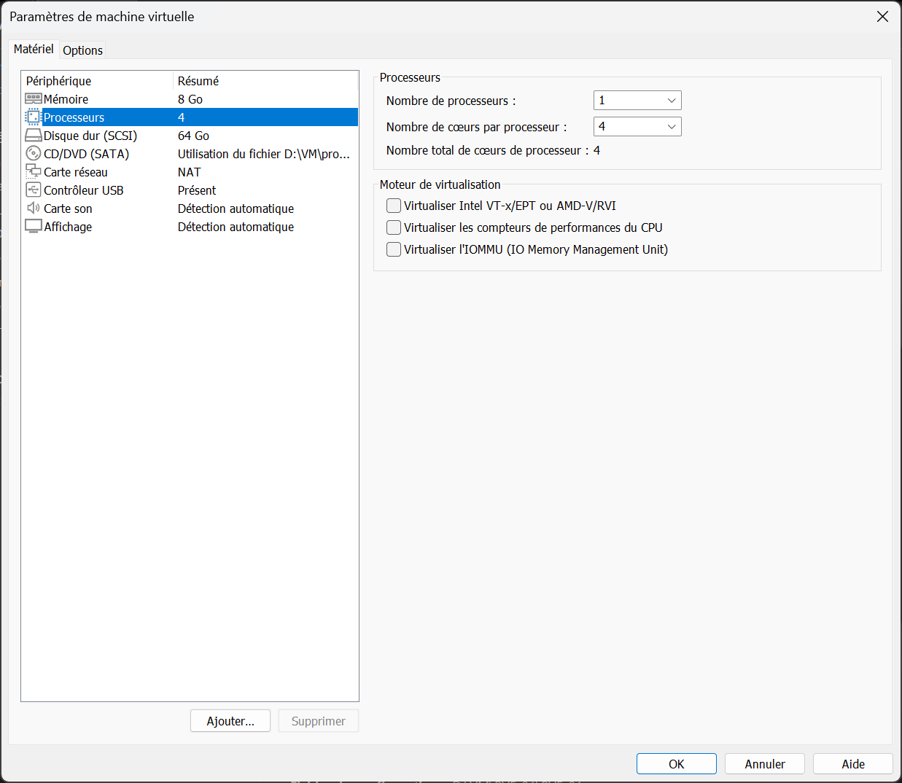

*Capture 08 : **Personnaliser le matériel → Processeurs** : « Virtualiser Intel VT-x/EPT ou AMD-V/RVI » **décoché**, selon la consigne du formateur. Windows utilise déjà la virtualisation (Hyper-V) et ne peut pas la transmettre à la VM : avec la case cochée, la VM refuse de démarrer.*

### Synthèse de la VM

| Paramètre | Valeur |
|---|---|
| Système invité | Debian 13.x 64 bits |
| Processeurs | 1 socket × 4 cœurs |
| Mémoire | 8 Go |
| Disque | 64 Go, SCSI, provisionnement dynamique, fichier unique |
| Réseau | NAT (VMnet8, `192.168.190.0/24`) |
| VT-x/EPT virtualisé | désactivé |

---

## 5. Installation de Proxmox VE


*Capture 09 : menu de démarrage de l'ISO → **Install Proxmox VE (Graphical)**.*

> [!TIP]
> Dans Workstation : cliquer dans la VM pour lui donner le clavier, `Ctrl + Alt` pour récupérer la souris.

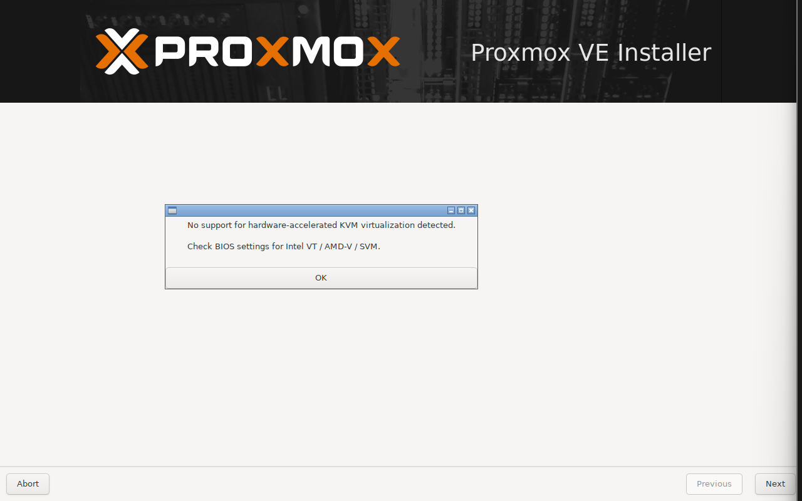

*Capture 10 : « No support for hardware-accelerated KVM virtualization detected ». C'est la conséquence attendue de VT-x décoché. Proxmox s'installe et fonctionne normalement, seules les VM KVM créées **dans** Proxmox seront plus lentes (les conteneurs LXC ne sont pas concernés).*

Licence (EULA) → **I agree**.

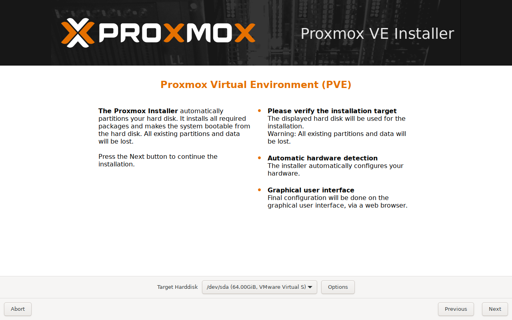

*Capture 11 : disque cible `/dev/sda` (64 Gio). Toutes les données de ce disque sont effacées. Système de fichiers par défaut : **ext4**, suffisant pour un seul disque.*


*Capture 12 : Switzerland · Europe/Zurich · **Swiss-French**. L'heure doit être juste (journaux, certificats), et le clavier doit correspondre au poste avant de saisir le mot de passe.*

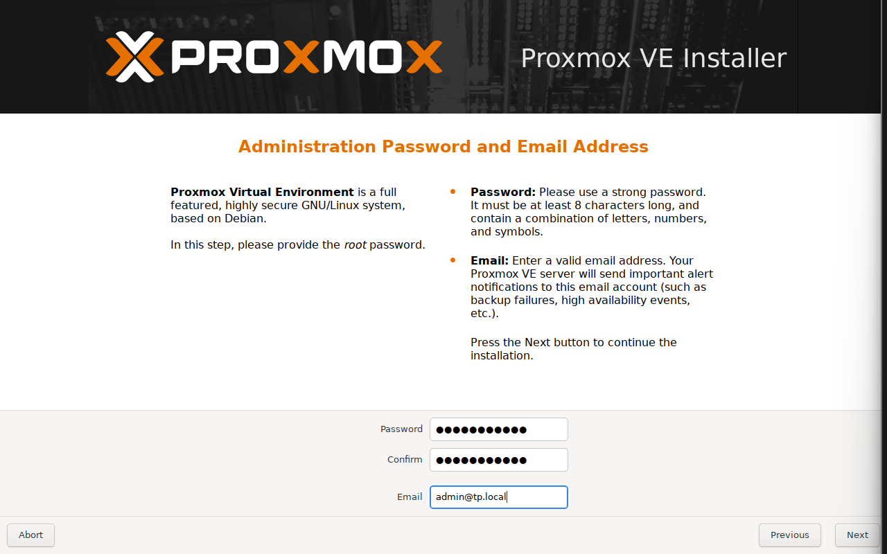

*Capture 13 : mot de passe du compte **root** (administrateur) et email pour les alertes (`admin@tp.local`, adresse fictive pour le TP). L'adresse par défaut `mail@example.invalid` est refusée par l'installeur. Le mot de passe n'est volontairement pas indiqué dans ce document.*

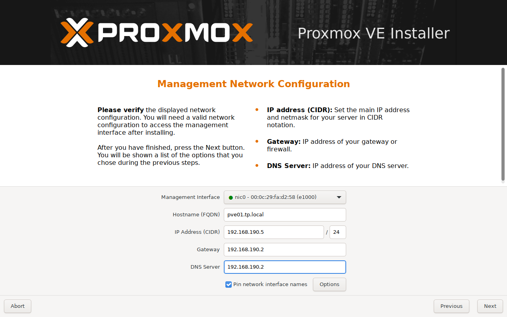

*Capture 14 : configuration réseau de gestion.*

| Champ | Valeur | Explication |
|---|---|---|
| Hostname (FQDN) | `pve01.tp.local` | nom complet = nom de la machine (`pve01`) + domaine (`tp.local`). Chaque nœud d'un cluster doit avoir un nom unique |
| IP Address (CIDR) | `192.168.190.5/24` | adresse **fixe**. Celle proposée (`.141`) venait du DHCP de VMware et pouvait changer. `.5` est hors de la plage DHCP de VMware (`.128` à `.254`) |
| Gateway | `192.168.190.2` | passerelle du NAT VMware, la sortie vers Internet |
| DNS Server | `192.168.190.2` | serveur DNS du NAT VMware, traduit les noms en adresses IP |

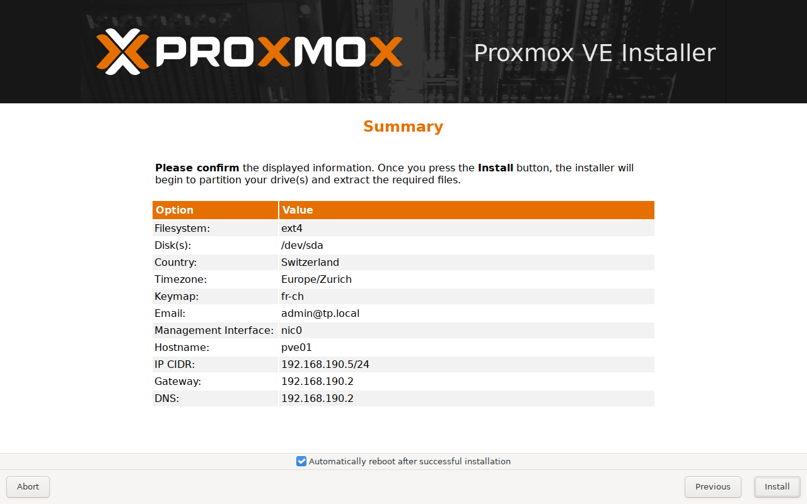

*Capture 15 : récapitulatif avant installation, avec redémarrage automatique coché → **Install**.*

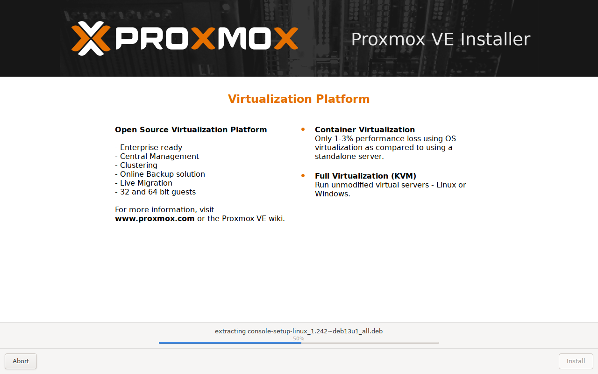

*Capture 16 : l'installeur partitionne le disque, puis extrait les paquets Debian 13 (`deb13`) et Proxmox.*

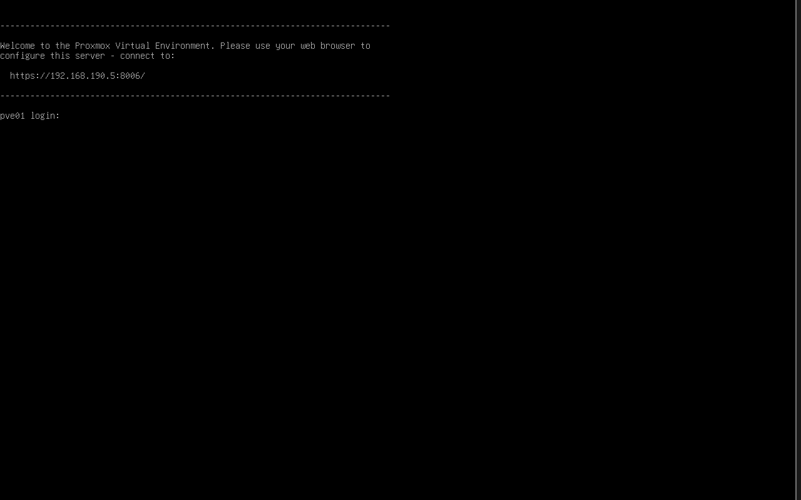

*Capture 17 : après redémarrage, la console indique l'adresse de l'interface web `https://192.168.190.5:8006/`.*

---

## 6. Accès à l'interface web

Depuis le **navigateur du PC Windows** : `https://192.168.190.5:8006`

> [!NOTE]
> Le navigateur affiche « Votre connexion n'est pas privée » : Proxmox utilise un certificat HTTPS **auto-signé**, généré à l'installation. Pour un serveur de TP, on peut continuer (**Paramètres avancés → Continuer**).

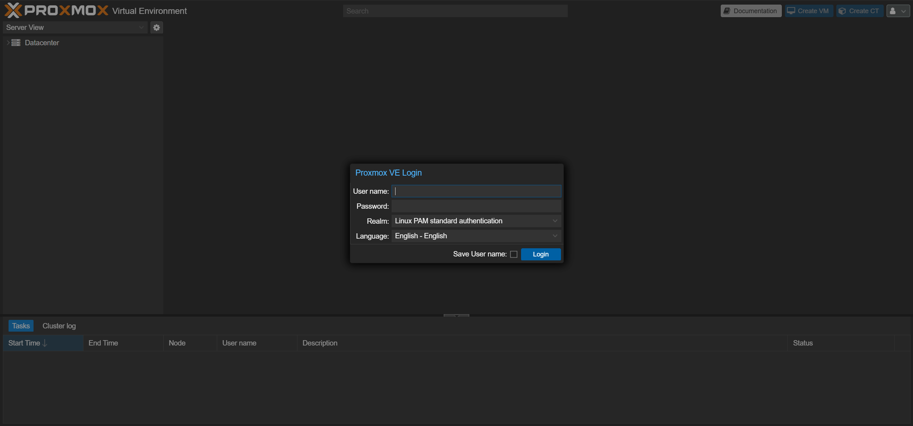

*Capture 18 : connexion avec l'utilisateur `root` et le domaine **Linux PAM standard authentication** (vérification via les comptes Linux du serveur).*

Une fenêtre « No valid subscription » s'affiche à la connexion : l'abonnement payant ne donne accès qu'au support et au dépôt « entreprise ». Proxmox reste entièrement fonctionnel sans abonnement → **OK**.

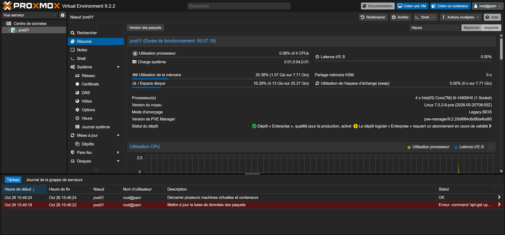

*Capture 19 : **Centre de données → pve01 → Résumé** : 4 CPU i9-14900HX, 7,7 Gio de RAM, Proxmox VE 9.2.2, noyau Linux 7.0.*

---

## 7. Deuxième nœud et cluster

### 7.1 Dépôt de mises à jour gratuit

Par défaut, Proxmox cherche ses mises à jour sur le dépôt **Enterprise**, réservé aux abonnés (d'où une erreur `apt-get update`, voir [section 8.2](#82-erreur-apt-get-update-dépôt--enterprise-)).

**pve01 → Mises à jour → Dépôts** : on sélectionne les deux dépôts `enterprise.proxmox.com` (`pve` et `ceph-squid`) → **Désactiver**, puis **Ajouter → No-Subscription**.

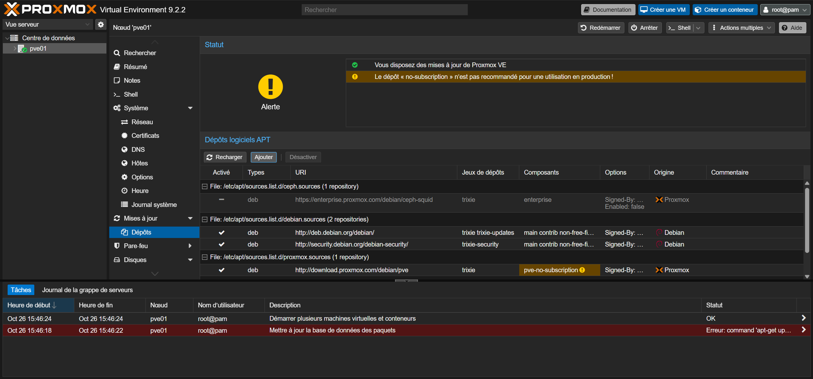

*Capture 20 : « Vous disposez des mises à jour de Proxmox VE ». L'avertissement jaune rappelle que le dépôt gratuit est moins testé que le dépôt Enterprise, ce qui est acceptable pour un TP.*

### 7.2 Installation du deuxième nœud

Une deuxième VM **PVE-02** (`D:\VM\PVE-02`) est créée avec exactement les mêmes réglages que PVE-01 (sections 4 et 5). Seuls changent :

| | PVE-01 | PVE-02 |
|---|---|---|
| Hostname | `pve01.tp.local` | `pve02.tp.local` |
| Adresse IP | `192.168.190.5/24` | `192.168.190.6/24` |

> [!NOTE]
> On réinstalle plutôt que de **cloner** PVE-01 : un clone garderait le même nom d'hôte, les mêmes clés SSH et les mêmes certificats, et le cluster refuserait le deuxième nœud.

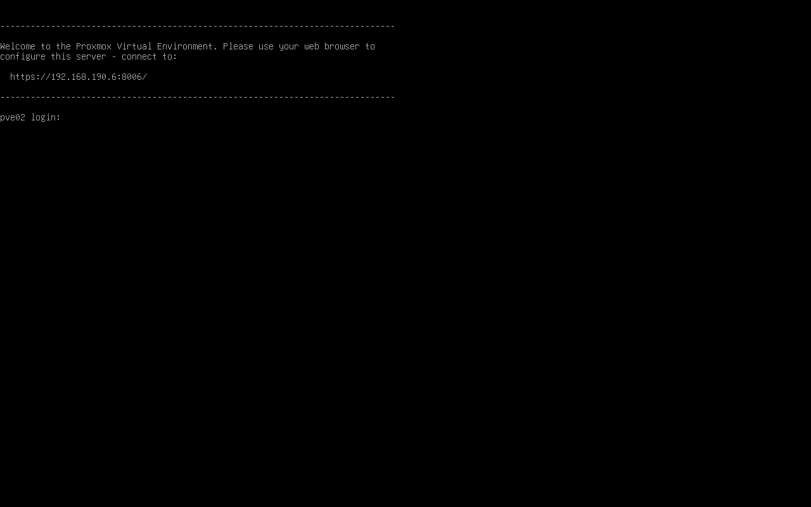

*Capture 21 : pve02 installé, joignable sur `https://192.168.190.6:8006/`.*

> [!TIP]
> **Comment choisir les adresses IP ?** L'installeur pré-remplit le réseau grâce au DHCP de VMware (`192.168.190.0/24`, passerelle et DNS `.2`). On le vérifie dans Workstation : **Modifier → Éditeur de réseau virtuel → VMnet8** (paramètres NAT et DHCP). Une IP fixe doit rester dans ce réseau en évitant `.1` (PC hôte), `.2` (passerelle), `.255` (diffusion) et la plage DHCP (`.128` à `.254`).

### 7.3 Création du cluster

Un **cluster** (« grappe de serveurs ») réunit plusieurs nœuds Proxmox administrés depuis une seule interface. On peut y déplacer des VM d'un nœud à l'autre.

Sur **pve01** : **Centre de données → Grappe de serveurs → Créer une grappe**, nom **`tp-cluster`**.

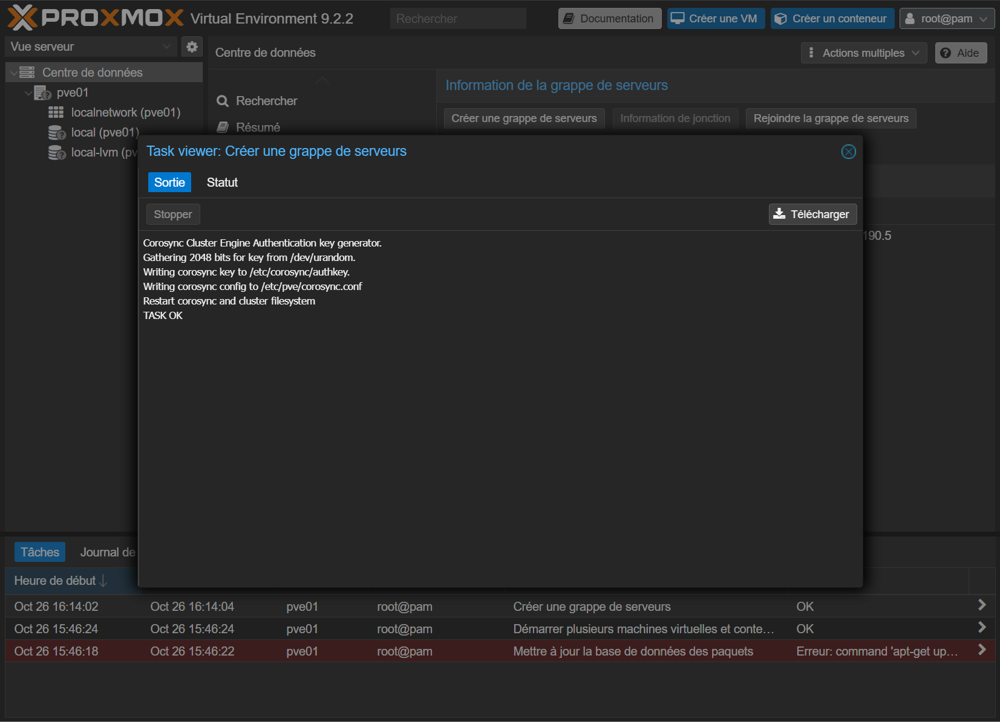

*Capture 22 : `TASK OK`. **Corosync** est le service qui fait communiquer les nœuds en permanence. Il génère une clé d'authentification (`/etc/corosync/authkey`) pour que seuls les membres du cluster se fassent confiance.*

Toujours sur pve01 : **Information de jonction → Copier les informations**.

### 7.4 Ajout de pve02 au cluster

Sur **pve02** (`https://192.168.190.6:8006`) : **Centre de données → Grappe de serveurs → Rejoindre la grappe de serveurs**. On colle les informations de jonction et on saisit le mot de passe root de pve01.

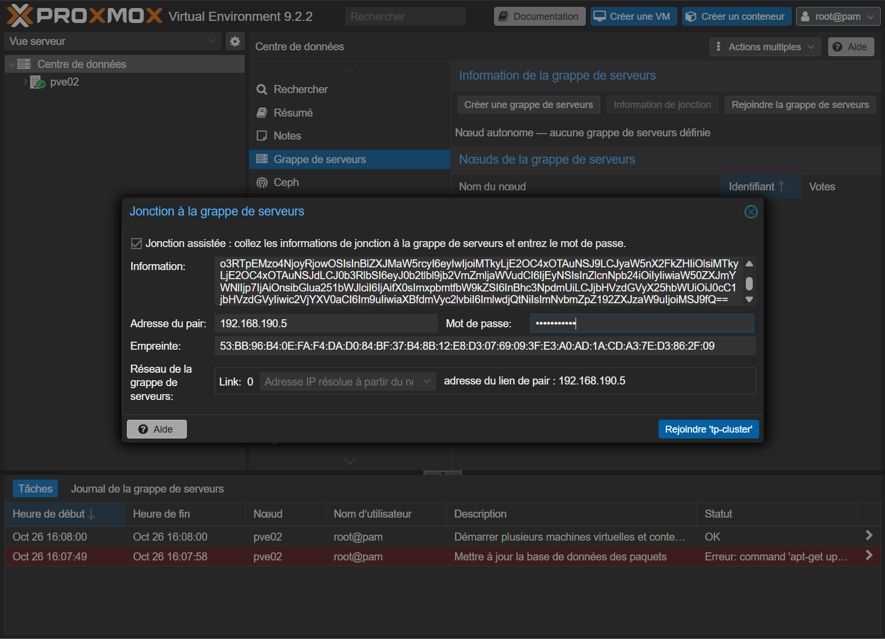

*Capture 23 : Proxmox déduit des informations collées l'adresse du pair (`192.168.190.5`) et l'**empreinte** de son certificat, ce qui permet de vérifier qu'on rejoint bien le bon serveur.*

Après **Rejoindre 'tp-cluster'**, la page de pve02 peut se figer : c'est normal, pve02 reçoit de nouveaux certificats. On recharge l'interface de pve01 (`F5`).

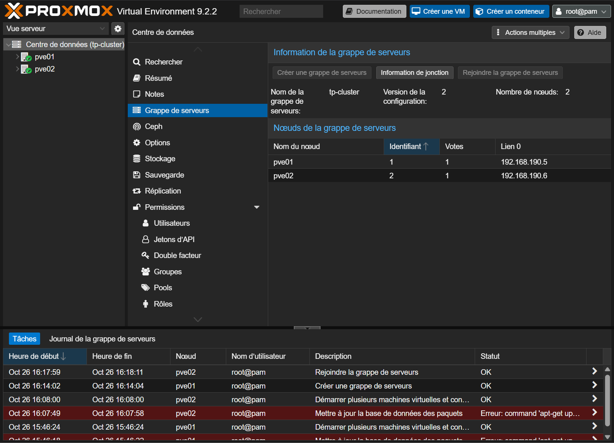

*Capture 24 : `tp-cluster` avec 2 nœuds, pve01 (`192.168.190.5`) et pve02 (`192.168.190.6`).*

> [!NOTE]
> **Votes et quorum :** chaque nœud dispose d'une voix. Le cluster ne fonctionne que si plus de la moitié des voix sont présentes (le **quorum**). Cela évite que deux parties isolées l'une de l'autre prennent des décisions contradictoires. Avec 2 nœuds, si l'un tombe, l'autre perd le quorum : en production, on utilise au moins 3 nœuds.

### 7.5 Double adressage IP (10.10.10.x)

Chaque nœud reçoit une **deuxième adresse IP** sur le réseau `10.10.10.0/24`, en plus de son adresse `192.168.190.x`. Une même interface réseau peut porter plusieurs adresses.

Sur **pve01 → Shell** :

```bash
nano /etc/network/interfaces
```

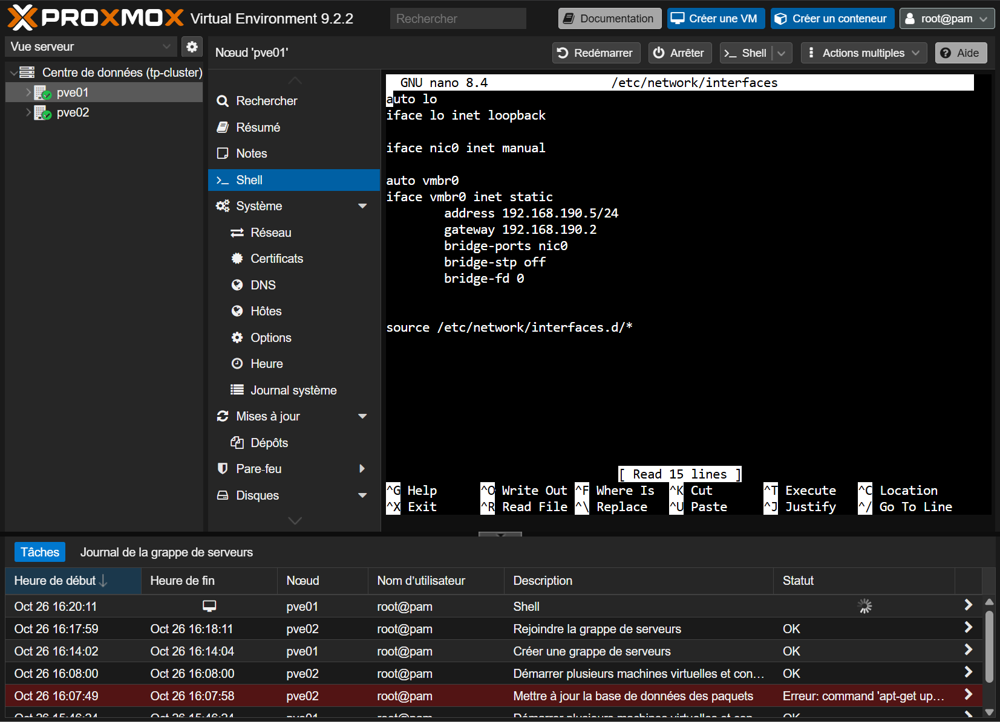

*Capture 25 : configuration d'origine. `vmbr0` est le **pont réseau** (bridge) de Proxmox, relié à la carte `nic0`. Les VM s'y branchent comme sur un switch virtuel.*

On ajoute une ligne `address` sous la première, dans le bloc `vmbr0` :

```
auto vmbr0
iface vmbr0 inet static
        address 192.168.190.5/24
        address 10.10.10.5/24
        gateway 192.168.190.2
        bridge-ports nic0
        bridge-stp off
        bridge-fd 0
```

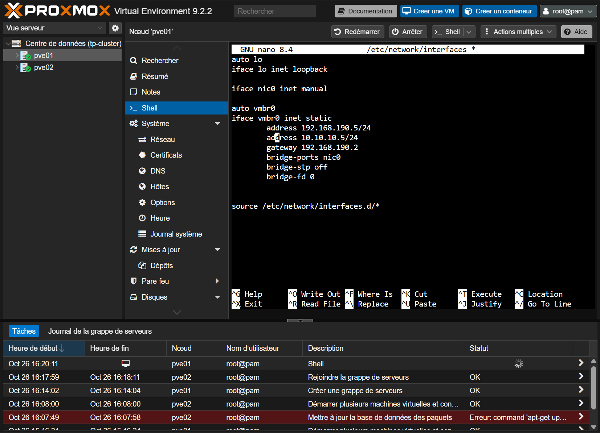

*Capture 26 : ligne ajoutée. Dans nano : flèches pour se déplacer, `Ctrl + O` puis `Entrée` pour enregistrer, `Ctrl + X` pour quitter.*

On applique la configuration et on vérifie :

```bash
systemctl restart networking && ip a show vmbr0
```

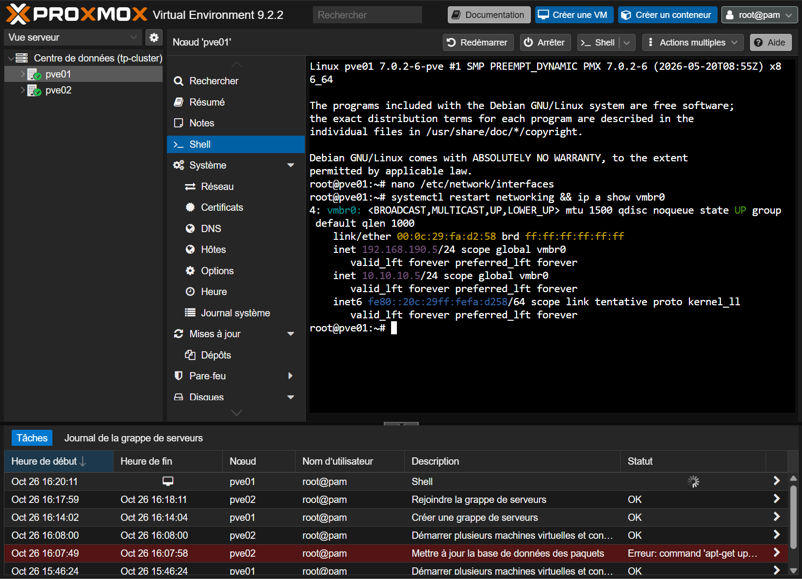

*Capture 27 : `vmbr0` porte `192.168.190.5/24` **et** `10.10.10.5/24`.*

Sur **pve02**, la même modification est faite en une seule commande avec `sed`, qui insère la ligne après l'adresse existante sans ouvrir d'éditeur :

```bash
sed -i '/address 192.168.190.6\/24/a\        address 10.10.10.6/24' /etc/network/interfaces && systemctl restart networking && ip a show vmbr0
```

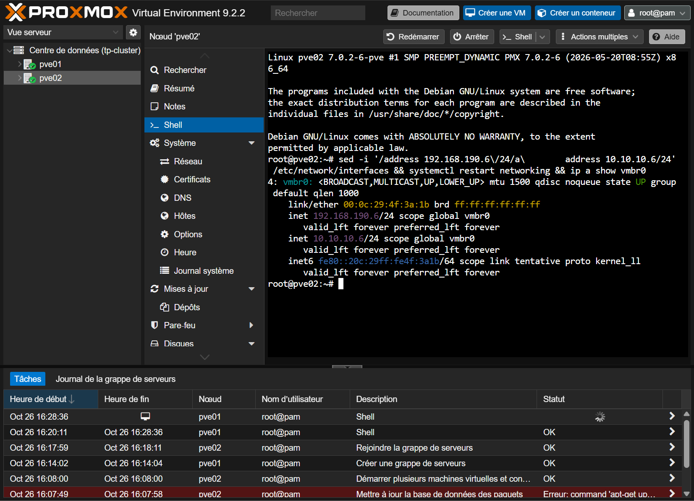

*Capture 28 : pve02 porte `192.168.190.6/24` et `10.10.10.6/24`.*

### 7.6 Test de communication

Depuis pve02 :

```bash
ping -c 3 10.10.10.5
```

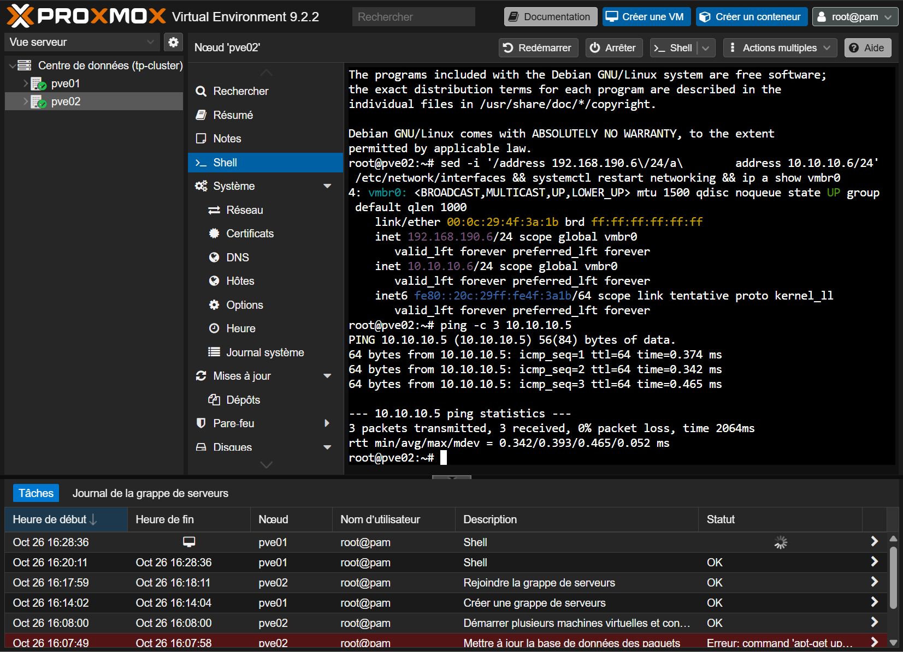

*Capture 29 : 3 paquets envoyés, 3 reçus, **0 % de perte**. Les deux nœuds communiquent sur le réseau `10.10.10.0/24`.*

---

## 8. Problèmes rencontrés et résolutions

### 8.1 Mauvaise ISO (arm64)

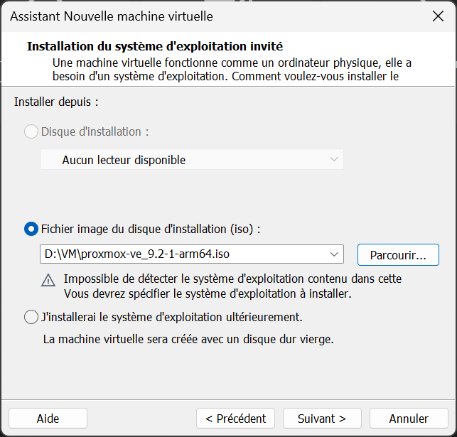

*Le premier fichier téléchargé était `proxmox-ve_9.2-1-arm64.iso`.*

- **Cause :** l'architecture ARM64 concerne les processeurs ARM (smartphones, Mac Apple Silicon…). Le i9-14900HX est un processeur x86-64.
- **Solution :** télécharger **Proxmox VE 9.2 ISO Installer** (sans « arm64 »).

### 8.2 Erreur `apt-get update` (dépôt « Enterprise »)

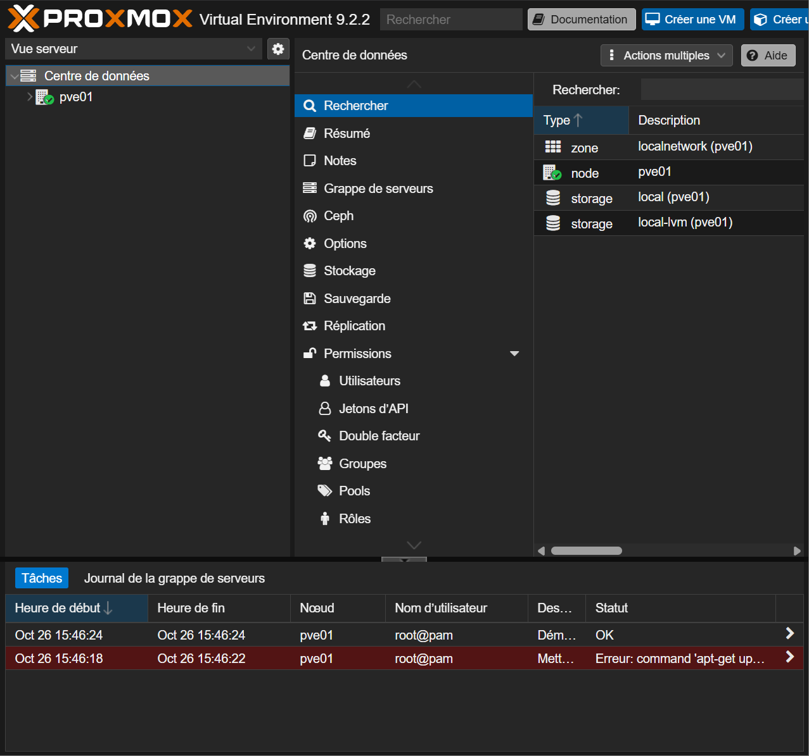

- **Cause :** par défaut, Proxmox se met à jour depuis le dépôt **Enterprise**, réservé aux abonnés payants.
- **Solution :** désactiver les dépôts Enterprise et ajouter le dépôt **No-Subscription** (voir [section 7.1](#71-dépôt-de-mises-à-jour-gratuit)).

### 8.3 Faute de frappe dans `/etc/network/interfaces`

Lors de l'édition, la ligne a d'abord été saisie `adress` (un seul « d »). Linux n'aurait pas reconnu ce mot-clé. On a supprimé la ligne dans nano avec `Ctrl + K` et on l'a retapée correctement **avant** de redémarrer le réseau.

> [!TIP]
> Toujours relire un fichier de configuration réseau avant de l'appliquer : une erreur peut couper l'accès au serveur.

---

## 9. Bilan

| Nœud | VM Workstation | Hostname | IP de gestion | IP secondaire |
|---|---|---|---|---|
| 1 | PVE-01 | `pve01.tp.local` | `192.168.190.5/24` | `10.10.10.5/24` |
| 2 | PVE-02 | `pve02.tp.local` | `192.168.190.6/24` | `10.10.10.6/24` |

- ✅ Proxmox VE 9.2 installé sur deux VM VMware Workstation
- ✅ Administration via l'interface web (port 8006)
- ✅ Dépôt de mises à jour gratuit (no-subscription) configuré
- ✅ Cluster `tp-cluster` à 2 nœuds
- ✅ Double adressage IP configuré en ligne de commande, communication vérifiée par `ping`

**Compétences mises en œuvre :** comparaison ESXi / Proxmox VE, dimensionnement de VM, choix d'un adressage IP fixe, installation d'un hyperviseur basé sur Debian, gestion des dépôts APT, création d'un cluster Proxmox (Corosync, quorum), édition de `/etc/network/interfaces` avec `nano` et `sed`.

---

## 10. Glossaire

| Terme | Définition |
|---|---|
| Hyperviseur de type 1 | logiciel qui s'installe directement sur le matériel pour héberger des VM (Proxmox VE, ESXi) |
| Hyperviseur de type 2 | logiciel de virtualisation qui tourne sur un système d'exploitation (VMware Workstation) |
| KVM | *Kernel-based Virtual Machine*, la virtualisation complète intégrée au noyau Linux |
| LXC | *Linux Containers*, des conteneurs légers qui partagent le noyau de l'hôte |
| Nœud | un serveur Proxmox membre (ou non) d'un cluster |
| Cluster | groupe de nœuds administrés ensemble depuis une seule interface |
| FQDN | *Fully Qualified Domain Name*, nom complet d'une machine (`pve01.tp.local`) |
| CIDR | notation d'un masque réseau : `/24` = `255.255.255.0` |
| NAT | traduction d'adresses : la VM sort sur Internet avec l'adresse du PC hôte |
| Certificat auto-signé | certificat HTTPS signé par le serveur lui-même, non reconnu par les navigateurs |
| Provisionnement dynamique (*thin*) | le fichier disque grossit au fur et à mesure de son utilisation |
| Dépôt APT | serveur depuis lequel Debian/Proxmox télécharge ses paquets et mises à jour |
| Corosync | service de communication entre les nœuds d'un cluster Proxmox |
| Quorum | majorité de voix nécessaire au fonctionnement d'un cluster |
| vmbr0 | pont réseau (bridge) virtuel de Proxmox, auquel se connectent l'hôte et les VM |
| nano | éditeur de texte en ligne de commande |
| sed | outil qui modifie le contenu d'un fichier en ligne de commande |
| ping | commande qui teste si une machine répond sur le réseau |
